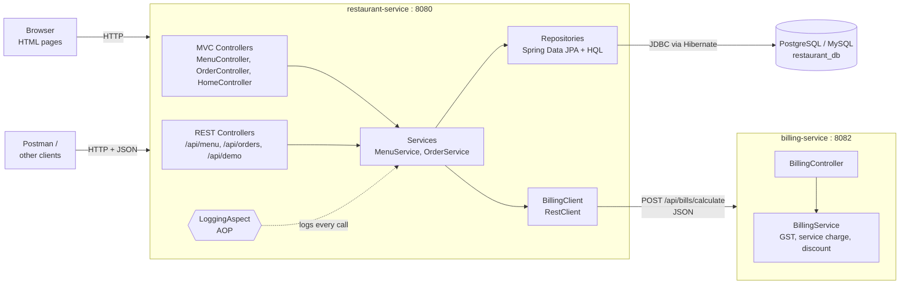
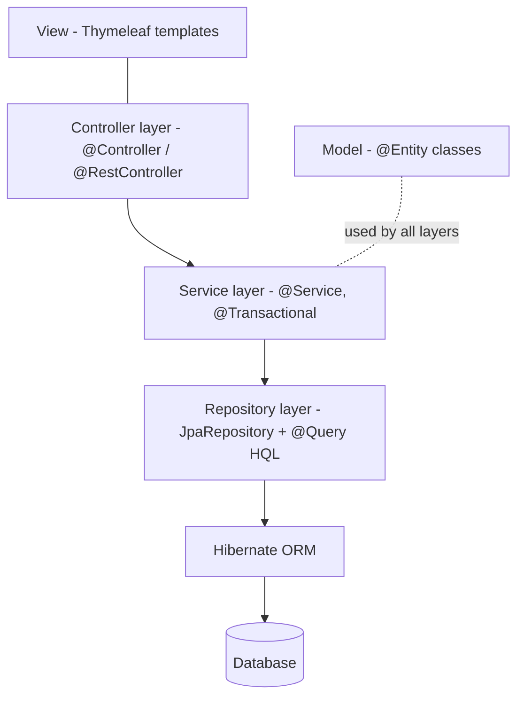
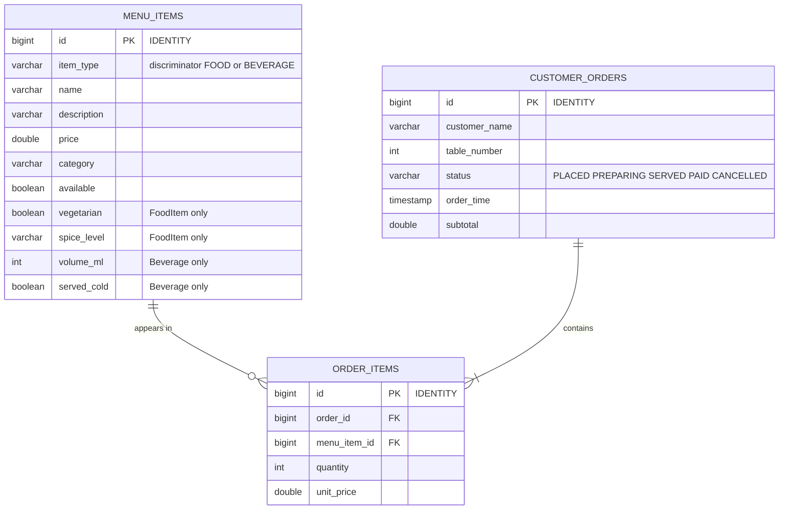
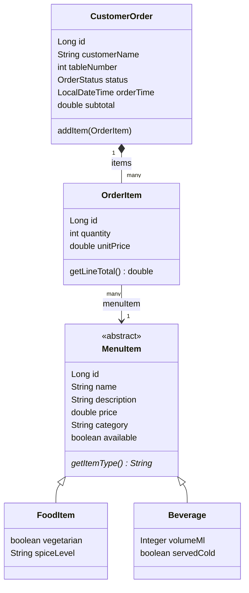
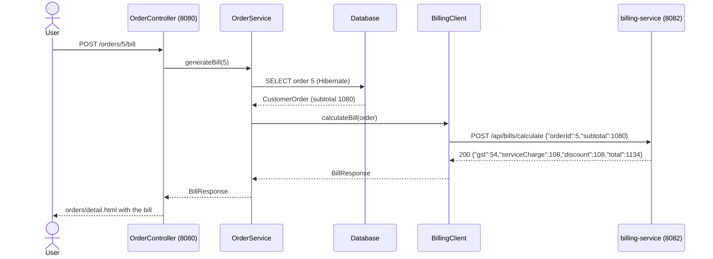

# Architecture

GitHub and VS Code render these diagrams automatically. For the report, paste a diagram into https://mermaid.live and export it as PNG.

## 1. System architecture (microservices)

The two services are **separate Spring Boot applications**: separate `pom.xml`, separate process, separate port.
They only talk to each other through REST/JSON. If billing-service is stopped, the restaurant app keeps working
and only the "Generate bill" feature shows an error (HTTP 503 in the API).

## 2. Layered design inside restaurant-service

## 3. Entity–Relationship diagram

## 4. Class diagram (entities and inheritance)

## 5. Sequence: generating a bill (service-to-service REST call)

